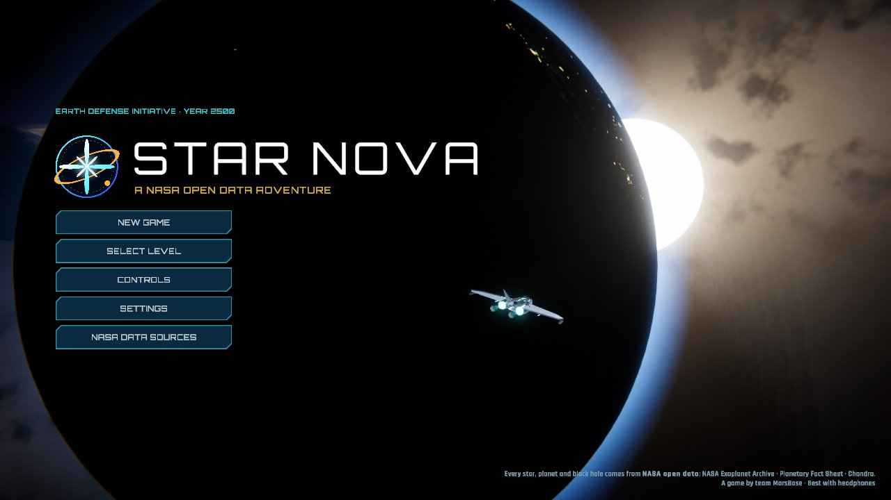
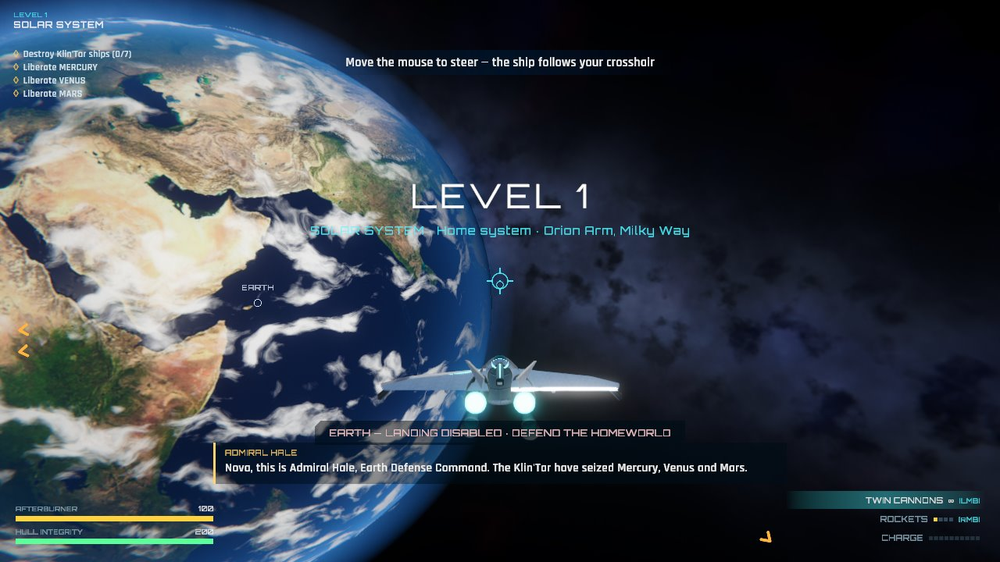
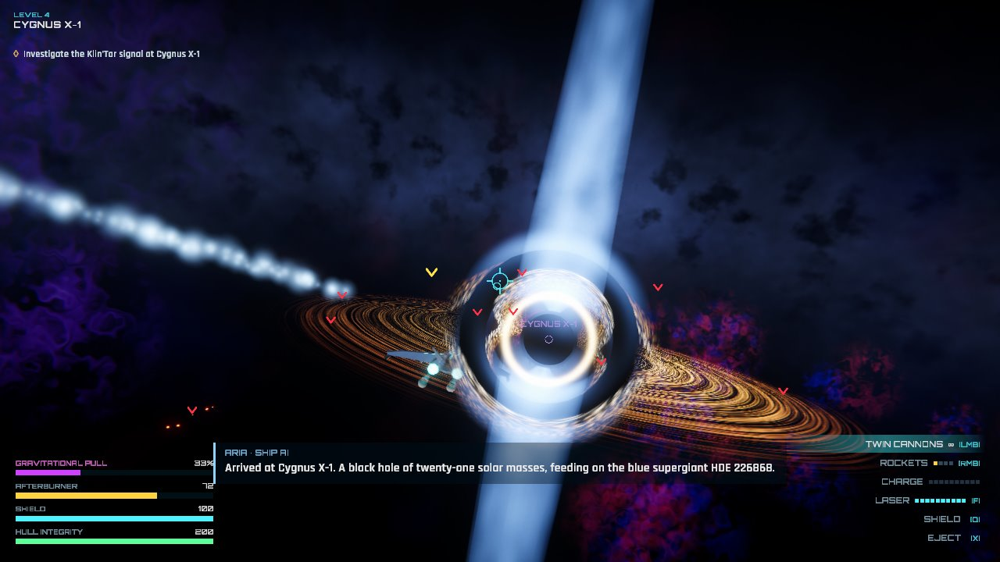
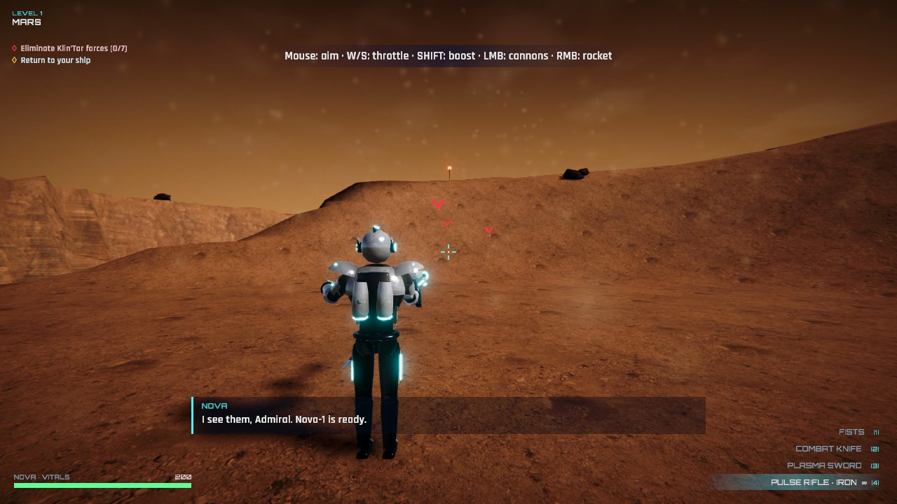
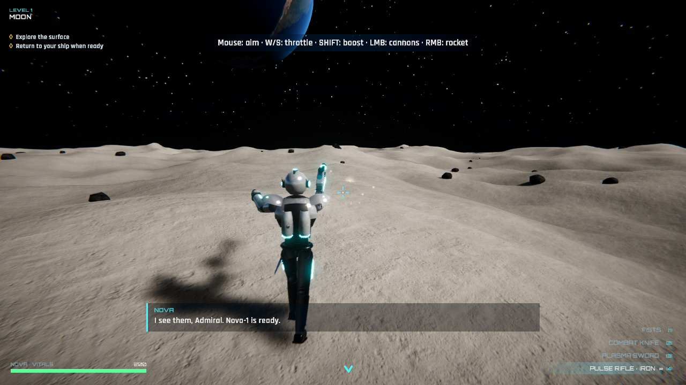

# Star Nova

**Star Nova** is a 3D space-action game for Windows, made in **Unity 6** and set in **real star systems from NASA open data**, by team **MarsBase** for the NASA Space Apps Challenge.
In 2300 the Klin'Tar Empire began conquering every inhabited world of the Milky Way. In 2500 it reached Earth — and humanity answered with a living weapon: **Nova**.

## Download and play
**[Download StarNova-Setup-1.0.0.exe](https://github.com/m1ller750/star-nova/releases/download/v1.0.0/StarNova-Setup-1.0.0.exe)** (192 MB, Windows 10/11 64-bit) · [all releases](https://github.com/m1ller750/star-nova/releases) · [game page](https://m1ller750.github.io/star-nova/)

1. Run the installer. It installs for your user only, so no administrator rights are needed. If Windows SmartScreen says "Windows protected your PC", click **More info → Run anyway** (the installer is not code-signed yet).
2. Start **Star Nova** from the Start menu or the desktop shortcut. Headphones recommended — the story is fully voiced.
3. To remove it: Windows Settings → Apps → Star Nova. Saved progress is kept.

Silent install for labs and judging machines: `StarNova-Setup-1.0.0.exe /silent [/dir="C:\Games\Star Nova"] [/desktop]`.

**Requirements:** Windows 10/11 64-bit, a DirectX 12 graphics card (tested on a GeForce GTX 1650), 8 GB RAM, 300 MB of disk space, keyboard and mouse.

## Levels (all bodies are real — NASA Exoplanet Archive / NASA Planetary Fact Sheet / NASA Chandra)
1. **Solar System** — dog-fights over Earth, liberate Mercury, Venus and Mars; the Sun overheats your hull.
2. **Kepler-90 (KOI-351)** — energy shield, the colonizer ring ship around Kepler-90 h, hostages, a 5:00 fusion charge, the Keplerian homeworld Kepler-90 f.
3. **TRAPPIST-1** — ship laser, EVA flight, back missiles, three different fortresses, the public execution on TRAPPIST-1 e (arms dealer, sniper rifle, smoke grenade).
4. **Cygnus X-1** — the black-hole trap, eject before the missile hits, eye lasers, void creatures, the portal.
5. **HR 8799** — infinite flight, titan punch, leaping onto comets and ships, hurling comets into dreadnoughts, the Shadow Guard, gorilla-beasts and the final boss.

Comets are the only fictional bodies. Every level is open from the start: **SELECT LEVEL** on the title screen or in the pause menu jumps straight to any of the five systems. Checkpoints are saved after every level.

| | |
|---|---|
|  |  |
|  |  |

## Controls
Ship: mouse aim · W/S throttle · A/D roll · Shift boost · LMB cannons · RMB rockets · Q shield · F laser · X eject · E land · J jump.
On foot / flying: WASD · Space jump (again in the air = fly) · C crouch · Shift sprint/boost · 1–5 weapons · LMB/RMB attack/aim · Z sight · F melee/takedown · R missiles · Q eye lasers · G smoke · X leap · E interact · V 1st/3rd person · Esc/P pause.

## Graphics
Unity 6.3 with the Universal Render Pipeline (Forward+, soft shadows, SSAO, HDR bloom, ACES tonemapping). Every surface carries real photo-scanned detail: CC0 PBR sets from Poly Haven and ambientCG on the terrain (three layers per world, recoloured to each planet's palette, triplanar rock on cliffs), on Nova's armour, ship hulls and buildings; boulders are Poly Haven photo scans. The Solar System bodies wear real NASA imagery — Blue Marble with city lights on the night side for Earth, MESSENGER for Mercury, Clementine for the Moon, Viking for Mars, NASA maps of Jupiter, Saturn and Neptune. Exoplanets stay procedural (nobody has photographed them yet). God rays from the stars, gravitational lensing around Cygnus X-1, and volumetric-looking nebulae.

Aim assist is built in for the ship cannons, Nova's rifle and the eye lasers. Enemies carry a single red marker; worlds still held by the Klin'Tar are ringed in gold. The ship's hull and Nova's suit repair themselves when out of fire.

## Repository
- `index.html` + `screenshots/` — the game page on GitHub Pages (https://m1ller750.github.io/star-nova/).
- The installer is attached to each [GitHub release](https://github.com/m1ller750/star-nova/releases). The Unity project itself is kept outside this repository for now (its photo-scanned textures and baked audio are large).

## Credits
Data: NASA Exoplanet Archive, NASA Planetary Fact Sheet, NASA Chandra. Planet imagery: NASA (Blue Marble, Earth at Night, MESSENGER, Clementine, NASA 3D Resources). Textures and rock scans: Poly Haven and ambientCG (CC0). Fonts: Orbitron and Rajdhani (SIL Open Font License).
